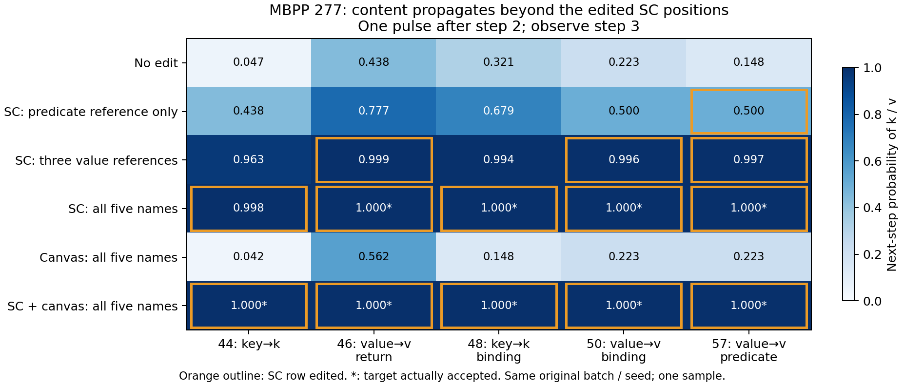
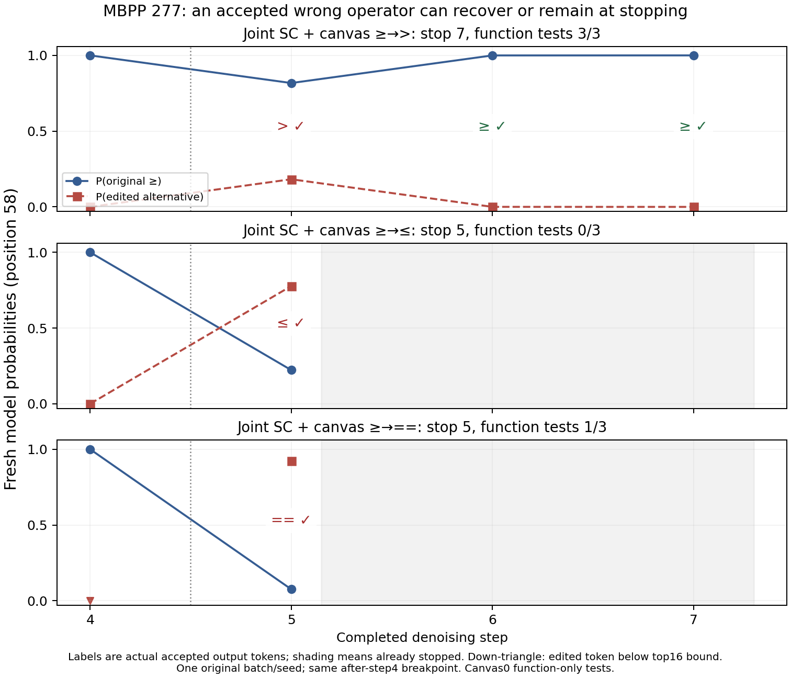
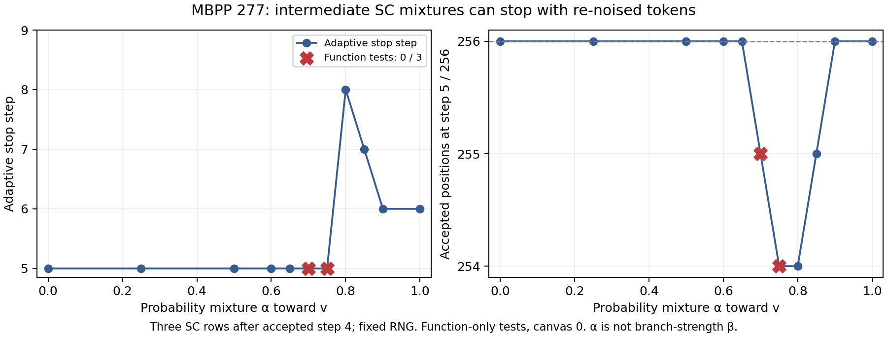

# 中期报告：SC 内容干预的四类操作与观察

2026-11-19。第一方向的**单样本机制研究**，不是六组 benchmark 分数表。

**核心发现：SC 的候选内容能影响下一轮的内容选择与跨位置协调，但影响取决于
修改范围、canvas 是否一致以及停止时机。许多错误编辑会被修复；部分联合编辑则
会在停止时保留错误逻辑。** 现有材料足以在中期报告中展示这些现象，尚不能据此
断言 SC 独立承担推理，或推断所有样本的规律。

## 固定样本与操作顺序

MBPP 277 要求保留字典中 `value >= n` 的项。原始正确函数为：

```python
def dict_filter(d, n):
    return {key: value for key, value in d.items() if value >= n}
```

保持原 batch=4、focus=2、seed=100008。恢复同一个断点，在完成 step t 后编辑
将被下一轮使用的 SC 或 canvas，再观察 step t+1 起的采样、接受、重新加噪和停止。
位置从0开始；step从1开始。主要位置：值引用46/50/57，比较符号58，阈值59，
未编辑的键位置44/48，参数14。实际位置以逐步CSV为准。

这里的“已接受”不是永久锁定；后续轮仍可能重新加噪。SC也包含已接受位置的反馈。
必须区分 denoiser argmax、实际采样 token 和 accepted mask。

## 四类操作：怎么改、发生什么、说明什么

| 操作 | 代表观察与匹配对照 | 可以支持的结论 |
| --- | --- | --- |
| **O1 候选 logits 交换** | step4后，仅交换return处的value/v会被修复；同时交换三处关联位置46/50/57，则在step5接受v，step6停止，得到正确的等价改名程序，3/3测试通过。比较符号的单点交换也有恢复原意的例子。 | 在保持所编辑行entropy及概率值集合不变时，候选身份仍能影响生成；一致关联位置比单点更容易产生稳定变化。不是所有交换都会被采用。 |
| **O2 SC 分布替换／混合** | `p'=(1-alpha)p+alpha*q`。step2后三处value反馈改为v，未编辑的key位置也转向k，最终得到正确k/v程序。step4后的强度扫描并不单调：alpha=.65正确，.70/.75出现停止时残留噪声，.80恢复正确，1.0得到正确改名。 | SC内容能跨位置影响候选选择；同时会改变置信度、接受与停止。效果不等同于“强度越大破坏越大”。alpha是分布混合系数，不是benchmark中支路缩放beta。 |
| **O3 SC embedding 清零** | step2后只清零目标符号行，step6停止；单次清零全部256行，step8停止；清零其余255行仅保留目标原反馈，step9停止。三者均通过3/3函数测试，baseline为step5。 | 该例中一次全局反馈移除比局部移除更延缓收敛，但模型可以恢复正确函数。不能把一次脉冲等同于每轮禁用SC，也不能由此判断SC不重要。 |
| **O4 当前 canvas token 替换** | step4后仅将三处值变量改为n，随后恢复，3/3通过；同时把SC也改为n，则step5停止，保留`n>=n`，0/3通过。符号<=的canvas-only与SC-only均恢复正确；联合修改后step5接受<=并停止，0/3通过。 | 当前文本与反馈的一致性会影响错误能否保留。联合效果不能归为SC单独作用；O4也用于分离可见文本与SC的贡献。 |

O1在精确算术下保持entropy，实际记录受dtype舍入影响；O2/O3不保证保持entropy。
O3是清零反馈向量，不是将logits设为0。四类是本项目的方法分类，不是来源论文的四项原方法。

## 三个适合展示的逐步现象

### 1. SC 内容传播到未编辑位置

三处value→v的SC-only编辑后，未编辑的两个key位置下一轮P(k)分别从
约.0474→.9626、.3208→.9941。最后形成一致的k/v命名并通过测试。
单点编辑和原内容强化对照也保留在存档中。这是**等价程序的内容协调**，
不能把变量重命名本身称为算术推理改变。



### 2. 被接受的错误可以恢复，也可以在停止时保留

同在step4后联合修改比较符号：`>`在step5被实际采样并接受，step6恢复`>=`，
step7停止，3/3通过。注意step5的模型argmax仍为`>=`，不能说模型最高概率已改为`>`。
`<=`则step5被接受并同轮停止，0/3通过；`==`停于step5，1/3通过。
因此“下一轮出现目标token”与“最终逻辑改变”需要分别报告。



### 3. 局部重新加噪与全局停止可以同轮发生

step4后的三处v分布混合alpha=.75，在step5有两个位置重新加噪；模型各位置argmax
仍等于上一轮正确canvas，记录的float32平均entropy约.004869，实际原生停止器触发。
最终返回的canvas却包含噪声，函数测试0/3。原分支加两次精确重放均一致。
alpha=.80反而继续去噪至step8并恢复，说明这一现象与停止边界交互。



修改注释使模型多运行的对照中，alpha=.75的噪声能被修复，`<=`也能恢复，
但`n>=n`和`==`错误仍可保留。注释会改变forward输入；它只是辅助对照，
**不是只关闭停止器的干净消融**，不能把差异全部归因于多运行一步。

## 数量、验证与结论边界

- 166种去重操作序列：1个baseline、162个自然停止的扰动配置、3个重复脉冲中途前缀。
  范围、位置、时机、强度与联合通道是参数，不是新增方法。
- 完成配置中SC-only 90、canvas-only 21、joint 51。方法覆盖允许重叠，不能相加。
- 544份MBPP逐步导出通过原生前缀、采样/接受与canvas编辑连续性检查。
  18项干预精确重放一致，另有1项原生轨迹对照。
- 只有**1个独立prompt、1个随机seed**；重放不是独立统计样本，不给总体成功率或显著性。
- 所有3/3、0/3等分数均为canvas0中抽出的函数运行三个公开测试，
  **不是完整多canvas MBPP输出的benchmark分数**。代码块后续文字可能仍未生成完整。
- 该例支持SC参与内容选择、协调和收敛；尚不能证明“思考完全存在SC中”，
  也不能由未改变最终答案推断其他内部特征占主导。跨样本复核仍是后续工作。

## 归档结构与复查方式

- [代表分支索引](selected_evidence.csv)：31个分支，附操作、断点、停止步及函数测试。
- [全部条件简表](tables/case277_interventions.csv)：适合阅读；
  [完整条件表](tables/filter_conditions.csv)含166条记录、操作JSON、最终canvas和测试细节；
  [逐操作表](tables/case277_operations.csv)保留各位置编辑。
- `evidence/<branch>/branch.json`与`steps.csv`是原文件的逐字节副本；
  `tokens_selected_positions.csv`明确只包含14、35、42至60、63这些展示位置。
  steps CSV仍保存全部位置的接受/重新加噪集合。branch中的原始CSV文件名是来源引用；
  本归档内使用上述统一文件名。
- `figures/`含PNG、PDF及`tables/`中的绘图数据。
- `provenance/`含模型SHA、原batch/prompt/seed、环境、验证报告、源码逐文件SHA，
  以及**实际驻留实验的源码包**`execution-source.tar.gz`。
- 原始264MiB快照包保留在本地忽略目录`outputs/`，SHA256见
  [archive.json](provenance/archive.json)。Git存档只保留精选轨迹与全条件索引，
  不包含权重或完整词表logits；保存的是top16候选。
- 方法分类及设计轴见[分类说明](../../docs/INTERVENTION_TAXONOMY.md)和
  [机器可读分类](../intervention_taxonomy/README.md)。

在仓库根目录运行，无需GPU：

```bash
python scripts/archive_interim_results.py --verify
```

从本地原始快照重建（保留本README），再校验：

```bash
python scripts/archive_interim_results.py
python scripts/archive_interim_results.py --verify
```

适合中期报告的总结句：**“固定样本与去噪断点的对照实验表明，SC内容既能影响下一轮
局部候选，也能协调相关位置；错误扰动可能被修复，或与canvas和停止机制相互作用而
保留错误。现阶段结论来自深入个例，后续将用少量独立样本验证其覆盖范围。”**
